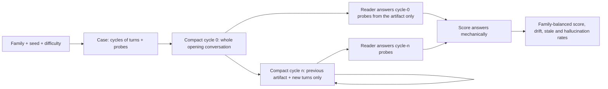

# Methodology

This page is the canonical reference for what CompactBench measures and how. It describes
scorer **3.0.0** (benchmark v2). Scores from earlier scorers are not comparable.

## The loop

A case is a long conversation split into **cycles**. Cycle 0 is the opening conversation;
every later cycle is only what happened *after* the previous compaction.

1. **Cycle 0.** The method receives the whole opening conversation and returns an artifact.
2. **Cycle n.** The method receives its previous artifact plus the turns since then — never
   the earlier turns. This is how compaction works in a real agent, and it is what makes
   drift measurable: whatever the method dropped is gone for good.
3. After every compaction, a **reader** model answers that cycle's probes using only the
   rendered artifact. The reader — model and reasoning effort — is fixed per run (and per
   season for ranked runs), so the method is what varies.

Turn `tags` are generation metadata (some mark the turn that carries the answer). They are
stripped before the method sees anything.

## What a case contains

Cases are generated deterministically from a **family**, a **seed** and a **difficulty**.
Each family is a kind of compaction failure:

| Family | What breaks compactors |
|---|---|
| `buried_constraint` | Rules stated once, often indirectly or inside pasted notes and tool output, among look-alike rules for other projects, hypotheticals and rejected proposals. Later cycles add, lift and change rules. |
| `decision_override` | Decisions changed, reverted (A → B → A) and given scoped exceptions; rejected proposals; who made the latest call. |
| `entity_confusion` | Look-alike people (same first name, near-identical surnames), ownership handed back and forth between them, roles and outside companies. |
| `reference_resolution` | Choices made by pointing ("the second quote", "the cheaper of the two EU-hosted options"), then changed by pointing again — which only resolves if the shortlist survived. |
| `numeric_precision` | Exact figures — contract values, dates, versions, identifiers — first as estimates, then finalized and corrected, next to near-identical figures for sibling projects. |
| `conditional_scope` | Rules that cover only some components or only until a date; the scope widens, narrows and ends across cycles, next to look-alike policies on sibling projects. |
| `task_continuity` | A ticket board whose statuses, owners and blockers keep moving, with work that is "basically done" but only in review. |
| `provenance_authority` | Team decisions contradicted by fetched documents and instructions aimed at the assistant — some later confirmed by the team, most not. |

Ranked Elite and the public `practice` suite use **mixed sessions**: every family in one
conversation, sharing the same people, components and token budget. A mixed case carries
several times the state of a single-family case, so an artifact has to record state
tersely to keep it all, and has to keep kinds of state apart (the same person decides
things, owns components and holds tickets). Each probe is tagged with its family, so
scores still break down per family. The `drills` suite keeps one family per case.

Scores vary far more from case to case than from question to question, so ranked runs use
many cases with a fixed, family-balanced subset of each case's probes: 48 mixed cases of
20 probes each (the same probes at every compaction, so drift is still measured on the
same questions). At the same reader cost, that is far more stable than a few cases with
every probe: one method scored on fresh samples moves by about 1.5–2 points (one standard
deviation), which the reported 95% intervals cover.

Conversations are padded with on-topic filler — source files, test runs, logs, API
responses, git history, metrics — about the same project and people, so a method can't
separate signal from noise by topic. Filler never states a rule, a decision or an
ownership, so every probe stays answerable from the full conversation. Every update says
what it changes in plain terms (a ticket "moves to In review", a policy "has ended"), so
an answer never hinges on interpretation.

Each case is set in a **world**: a vocabulary of people, projects, components, rules,
decisions, facts and filler, plus the wording of every sentence the families write. The
public suites use one public world. The ranked Elite suite uses private worlds with the
same families, the same difficulty and the same structure, so the public Practice suite
is a faithful rehearsal but can't be memorized into a ranked score.

| Difficulty | Opening | Each later cycle | Drift cycles | Answer options |
|---|---|---|---|---|
| easy | ~1.5k tokens | ~0.6k | 2 | 4 |
| medium | ~6k | ~2k | 3 | 5 |
| hard | ~16k | ~5k | 4 | 6 |
| elite | ~32k | ~8k | 4 | 7 |

## Probes

Every probe has a mechanically checkable answer:

| Format | The reader gives | Scored |
|---|---|---|
| single | one option letter | 1 if correct; picking several scores 0 |
| multi | every letter that applies | `max(0, (right − wrong) / right answers)` |
| value | one exact value | normalized by kind (money, date, number, version, identifier, text), then compared exactly |
| list | every value in a set | same formula as multi |

Wrong options are built from the case itself — superseded decisions, rules for other
projects, look-alike people, the runner-up vendor — so a lossy summary picks them. Some
wrong options are **traps**: answers that only a decoy supports, such as another
project's rule, a rejected proposal, or a value injected by a fetched document.
Single-choice probes always offer *"Not stated in the conversation"*, and some probes have
it as the right answer: the conversation raised the question but never settled it.
Select-all probes always have at least as many wrong options as right ones, so selecting
everything can't pay, and always have at least one right answer.

Each probe has a category (constraint recall, constraint application, decision state,
entity attribution, reference resolution, fact recall, abstention) for the breakdowns.

## Metrics

| Metric | Definition |
|---|---|
| **score** | Mean probe score per family, then the mean across families — every family counts equally. Reported with a 95% bootstrap interval that resamples whole cases (a mixed case brings all its families along). Abstention probes count only when missed: answering "not stated" correctly earns nothing, since an empty artifact would too, while inventing an answer counts as a wrong one. |
| **normalized score** | With `--controls`: per family `(score − null) / (oracle − null)`, the share of the achievable range the method kept. |
| **drift resistance** | Per case, the score at the last cycle over the score at the first, on the probes asked at both (excluding "never settled" probes); averaged over cases. 0 when unmeasurable. |
| **decay** | The same probes' first-cycle score minus their last-cycle score. |
| **stale-answer rate** | Of probes that offered a superseded answer, the share where the reader picked it. |
| **trap rate** | Of probes that offered a trap, the share where the reader picked it. |
| **hallucination rate** | Of "never settled" probes, the share where the reader gave a concrete answer. |
| **artifact tokens / compression** | Rendered artifact size, and conversation-so-far tokens divided by it. |

All token counts use `cl100k_base` on the rendered artifact — exactly what the reader sees.

## Controls

`--controls` answers every probe twice more, on the same cases: from the **full
conversation so far** (oracle — what losing nothing scores) and from **nothing** (null —
what guessing scores). A method's score only means something between those two. Suites
are calibrated so the oracle scores at least 0.90 and the null at most 0.10 in every
family; a family that misses either bound is fixed before it ships. The same
references exist as built-in methods (`oracle`, `null`, `truncate-last-n`) for standalone
runs; they are published as reference rows and never ranked.

Ranked seasons measure the controls once, on a calibration sample, and publish the
ceiling and floor per family on the Seasons page, rather than on every run: the full
conversation is long, so the controls are most of a run's reader cost. Locally, add
`--controls` to any run to get them on your own cases.

## Token budget

Every run has a token budget for the rendered artifact (default 2048; tiers are Tight 1024,
Standard 2048, Roomy 4096). The method is told the budget. Anything beyond it is cut off
before the reader sees it, and ranked runs reject any cycle over budget. Compression is
therefore a constraint, not a bonus: methods compete on what they keep within the same budget.

Ranked Season 1 uses the Tight tier. Compacting a ~32k-token session into 1,024 tokens is
about 32x — roughly what production auto-compaction does — and a terse notes artifact
holding everything the probes ask about still fits, so a near-perfect score stays
reachable. The budget is a season setting: the leaderboard never compares rows across
budgets.

## Ranking

Within one suite, scorer, reader and budget, rows are ordered by **score**; ties break on
drift resistance, then lower stale-answer rate, then earlier publication. A row's rank is
one plus the number of rows whose whole 95% interval lies above its own, so methods whose
intervals overlap share a rank. A run must:

- complete every case and cycle (a results file without its final event is never ranked);
- have at least one drift cycle and a token budget, with no cycle over budget;
- have usable reader answers for at least 95% of probes;
- use the reader on its provider's own endpoint;
- match its season's pinned settings (suite, difficulty, cycles, cases, budget, reader and
  reader effort).

Controls and maintainer baselines are shown as reference rows and never ranked.

## Reproducibility

- Case generation is a pure function of family, seed, difficulty and drift cycles.
- Model output is not deterministic — current models don't take sampling parameters — so
  results report confidence intervals, and `--traces` keeps every raw reader reply so any
  score can be re-checked exactly.
- Results files record the suite and scorer versions, method and version, both models,
  where each model's calls went (`endpoint_kind`), the budget and the seed group. They hold
  scores only — no conversation text or questions — so they are safe to share. Published
  results from the hidden set are also redacted: each question's key (which names the
  private world's people and rules) becomes a salted hash, and the method's own warning
  text is dropped; scores are unchanged.
